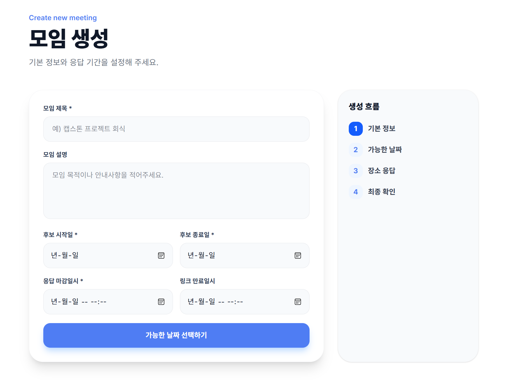
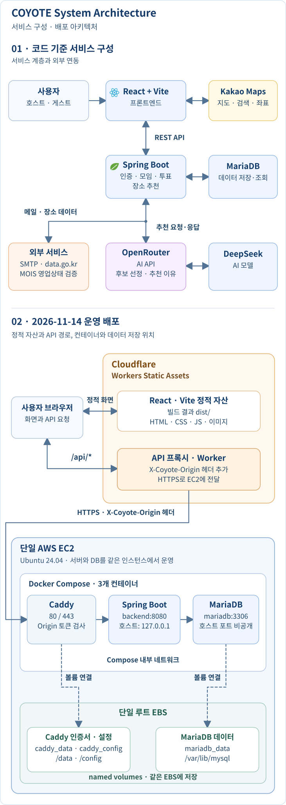
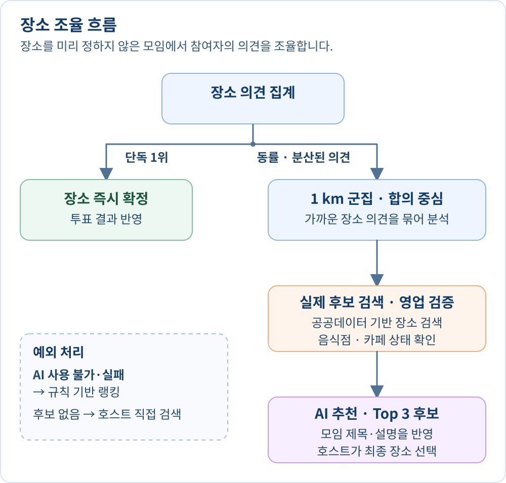
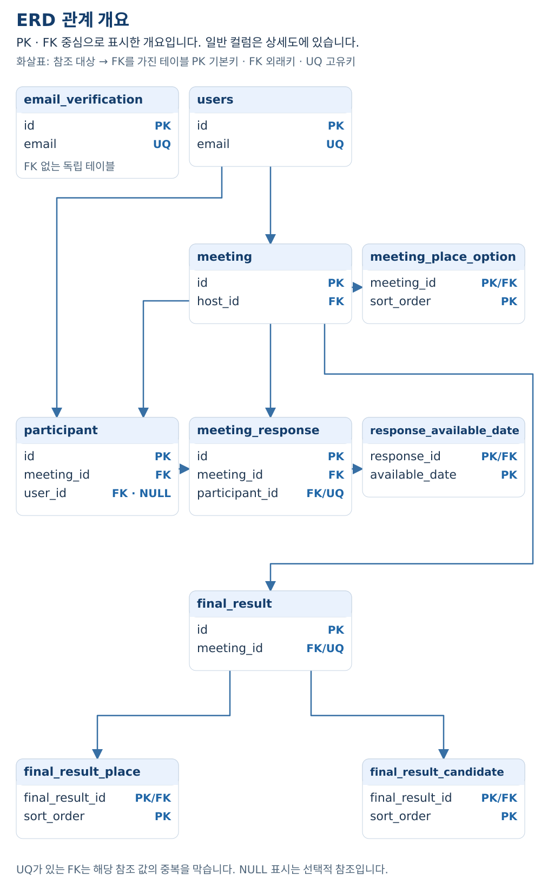
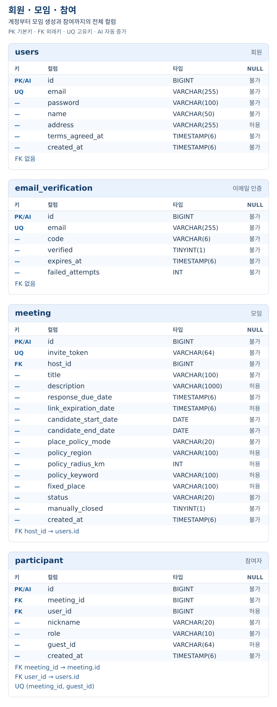
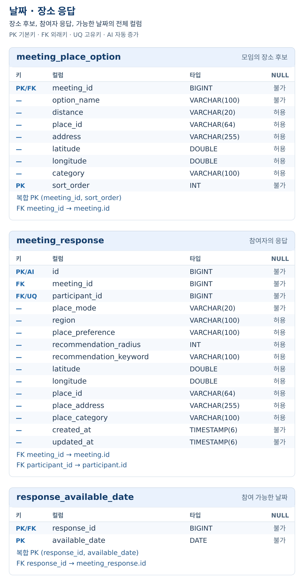
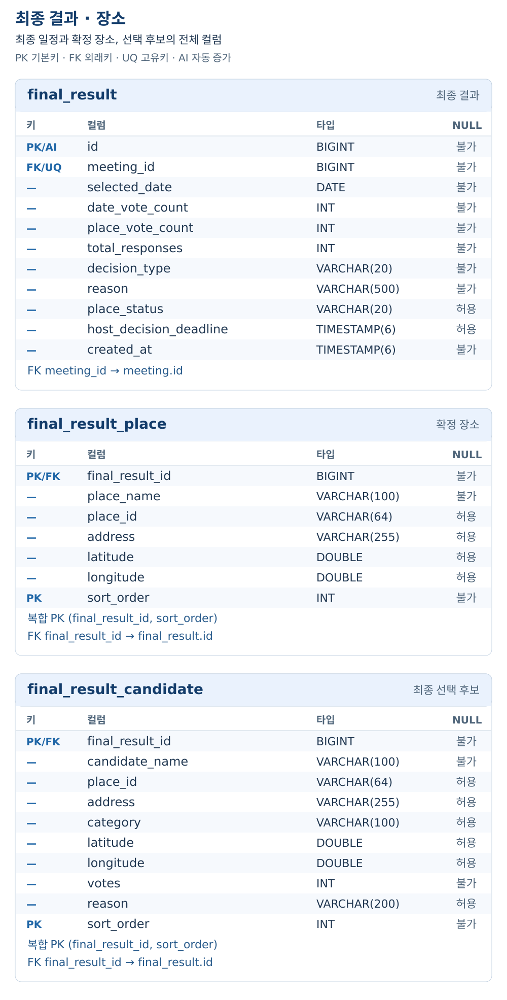

<h1 align="center">
  
</h1>

<p align="center">
  참여자의 가능한 날짜와 희망 장소를 모아<br>
  <strong>모임의 일정과 장소를 함께 정하는 웹 서비스</strong>
</p>

<p align="center">
  <a href="https://coyote-meeting.namse-coyote.workers.dev"><strong>서비스 둘러보기 ↗</strong></a>
  &nbsp; · &nbsp; <a href="#서비스-소개">서비스 소개</a>
  &nbsp; · &nbsp; <a href="#아키텍처">아키텍처</a>
  &nbsp; · &nbsp; <a href="#데이터-모델">ERD</a>
  &nbsp; · &nbsp; <a href="#핵심-설계">핵심 설계</a>
  &nbsp; · &nbsp; <a href="#시작하기">실행 가이드</a>
</p>

<br>

## 서비스 소개

단체 채팅에서 가능한 날짜를 반복해서 묻고, 장소를 따로 검색하고, 투표 결과를 다시 정리하는 일을 줄이기 위해 만들었습니다.

**모여ON은 날짜 투표부터 위치 기반 장소 조율, 모임 목적에 맞는 AI 추천과 최종 확정까지 연결합니다.** 호스트가 모임 조건과 초대 링크를 만들면, 게스트는 회원가입 없이 날짜와 장소 의견을 제출합니다. 서버는 응답을 집계하고 실제 장소 후보를 추려, 함께 만날 날짜와 장소를 정하도록 돕습니다.

### 01 · 모임의 조건을 정하고

후보 날짜, 응답 마감일과 장소 결정 방식을 설정합니다.

<p align="center">
  <a href="frontend/public/images/landing/step-01-create.png?raw=true">
    
  </a>
</p>

[모임 생성 화면 크게 보기 ↗](frontend/public/images/landing/step-01-create.png?raw=true)

<details>
<summary><strong>02 · 가능한 날짜를 모읍니다 — 화면 펼쳐보기</strong></summary>

참여자는 달력에서 날짜를 고르고 장소 의견을 제출합니다.

<p align="center">
  <a href="frontend/public/images/landing/step-03-dates.png?raw=true">
    
  </a>
</p>

[날짜 투표 화면 크게 보기 ↗](frontend/public/images/landing/step-03-dates.png?raw=true)

</details>

**모임 생성 → 초대 링크 공유 → 날짜·장소 응답 → 응답 마감 → 결과 확인**

| 할 수 있는 일 | 동작 |
| --- | --- |
| **링크로 참여** | 회원가입 없이 닉네임을 입력하고 참여합니다. |
| **날짜 투표** | 가능한 날짜를 제출하고 마감 전까지 수정합니다. 최다 득표 날짜가 모임 날짜가 됩니다. |
| **장소 조율** | 호스트가 장소를 지정하거나 추천 후보를 제공합니다. 장소를 미리 정하지 않았다면 참여자가 직접 제안하거나 의견을 건너뛸 수 있습니다. |
| **결과 확인** | 날짜와 장소 집계 결과를 확인합니다. 공동 1위나 공간 분석 후보 등 추가 선택이 필요한 경우 호스트가 장소를 정합니다. |
| **일정·지도 확인** | 확정된 약속을 캘린더에서 날짜별로 확인하고, 지도에서 모임 위치를 살펴봅니다. |

<details>
<summary>날짜 집계와 AI의 역할</summary>

날짜는 투표 집계 규칙으로 결정합니다. 최다 득표 날짜가 여러 개면 오늘과 가장 가까운 날짜를 선택합니다. AI는 모임의 제목·설명 등 맥락을 참고해 **실제 장소 후보의 선정과 추천 이유**를 보완합니다.

| 추천 시점 | 후보와 결과 |
| --- | --- |
| 모임 생성 중 직접 추천 | 최대 20곳의 후보에서 최대 6곳을 추천합니다. |
| 마감 후 추가 장소 분석 | 자유 장소 제안의 의견이 갈린 경우, 최종 선택 후보를 최대 3곳 제시하고 호스트가 선택합니다. |

[직접 추천 API](backend/src/main/java/com/coyote/moyeon/place/PlaceController.java) · [마감 후 선택 후보 생성](backend/src/main/java/com/coyote/moyeon/meeting/PlaceDecisionService.java)

</details>

<details>
<summary>호스트 인증과 게스트 참여 권한</summary>

| 참여 방식 | 인증과 권한 확인 |
| --- | --- |
| 호스트 | HttpOnly 쿠키의 JWT로 인증합니다. 인증 쿠키를 사용하는 변경 요청에는 CSRF 토큰을 검증하고, 호스트 전용 작업은 서버에서 모임 소유권을 확인합니다. |
| 게스트 | 초대 토큰과 `X-Guest-Id`로 참여와 응답을 식별합니다. 링크 만료와 응답 마감 여부를 확인하며, 마감 전에는 기존 응답을 수정할 수 있습니다. |

[인증 쿠키](backend/src/main/java/com/coyote/moyeon/auth/AuthCookieService.java) · [CSRF 검증](backend/src/main/java/com/coyote/moyeon/common/config/CookieCsrfFilter.java) · [게스트 참여 API](backend/src/main/java/com/coyote/moyeon/meeting/InviteController.java)

</details>

<br>

## 아키텍처

**서비스 구성과 실제 배포 구성을 한 장으로 정리했습니다.** 위쪽은 화면·서버·DB와 외부 API의 역할, 아래쪽은 Cloudflare에서 단일 AWS EC2까지 요청이 전달되는 경로입니다.

<p align="center">
  <a href="docs/assets/readme/architecture-deployment.svg?raw=true">
    
  </a>
</p>

<p align="center">
  <a href="docs/assets/readme/architecture-deployment.svg?raw=true">SVG 크게 보기 ↗</a>
  &nbsp; · &nbsp; <a href="docs/assets/readme/architecture-deployment.png?raw=true">고해상도 PNG</a>
  &nbsp; · &nbsp; <a href="docs/assets/readme/architecture.png?raw=true">제공된 원본 이미지</a>
  &nbsp; · &nbsp; <a href="deploy/ec2/README.md">배포 구성과 운영 문서</a>
</p>

> **기능과 운영 설정:** 음식점·카페 영업상태 검증 기능은 코드에 구현되어 있습니다. 저장소에 보관한 2026년 11월 14일 [운영 Compose 설정](deploy/ec2/compose.yaml)은 `MOIS_PLACE_STATUS_ENABLED=false`로 이 기능을 비활성화합니다.

<details>
<summary><strong>장소 조율 흐름 펼쳐보기</strong></summary>

장소를 미리 정하지 않은 모임의 처리 흐름입니다. **Top 3 후보 생성은 모임 마감 후 추가 장소 분석이 필요한 경우**에 적용됩니다.

<p align="center">
  <a href="docs/assets/readme/place-flow.svg?raw=true">
    
  </a>
</p>

[장소 조율 흐름 크게 보기 ↗](docs/assets/readme/place-flow.svg?raw=true)

</details>

<details>
<summary>운영 배포 구성 보기</summary>

2026년 11월 14일 확인한 운영 구성 기준입니다. Cloudflare Workers Static Assets가 Vite 빌드 결과를 제공하고, 같은 출처의 `/api/*` 요청은 Worker가 `X-Coyote-Origin` 헤더를 붙여 EC2의 Caddy로 전달합니다. Caddy가 Origin 토큰을 검사한 뒤 `backend:8080`으로 요청을 넘깁니다.

Caddy·Spring Boot·MariaDB는 단일 EC2의 Docker Compose 컨테이너 3개로 실행합니다. Caddy는 80·443 포트를 사용하고, 백엔드의 호스트 포트는 `127.0.0.1:8080`에 바인딩합니다. MariaDB는 Docker 내부 주소 `mariadb:3306`으로 연결하며 호스트에 포트를 공개하지 않습니다. DB와 Caddy의 named volume은 같은 EC2의 EBS에 저장합니다.

배포는 릴리스 파일과 셸 스크립트로 진행합니다. 자동 CI/CD, 정기 DB 백업과 자동 롤백은 향후 보완할 항목입니다.

배포 파일은 확인 당시의 스냅샷입니다. 재배포할 때는 [배포 문서](deploy/ec2/README.md)에 따라 릴리스 파일명, 이미지 태그, SQL 적용 경로와 빌드 결과를 확인합니다.

[Worker 설정](frontend/wrangler.jsonc) · [API 전달 코드](frontend/worker.js) · [Docker Compose](deploy/ec2/compose.yaml) · [Caddy](deploy/ec2/Caddyfile)

</details>

<br>

## 데이터 모델

모임을 중심으로 회원·참여자·응답·최종 결과를 연결한 **10개 테이블과 10개 외래키 관계**입니다. 참여자의 응답과 확정 결과를 분리해 저장하며, 회원 호스트와 비회원 게스트의 참여를 함께 지원합니다.

**관계 개요 → 영역별 상세** 순서로 확인할 수 있습니다. 아래 개요는 주요 키와 외래키 관계를 보여주며, 전체 컬럼·자료형·NULL 허용 여부는 상세 ERD에 담았습니다.

<p align="center">
  <a href="docs/assets/readme/erd-overview.svg?raw=true">
    
  </a>
</p>

<p align="center">
  <a href="docs/assets/readme/erd-overview.svg?raw=true">관계 개요 크게 보기 ↗</a>
  &nbsp; · &nbsp; <a href="docs/assets/readme/erd.png?raw=true">제공된 원본 이미지</a>
  &nbsp; · &nbsp; <a href="sql/coyote_backend_mj_schema.sql">전체 SQL 스키마</a>
  &nbsp; · &nbsp; <a href="sql/README.md">스키마 적용·변경 안내</a>
</p>

| 영역 | 주요 테이블 |
| --- | --- |
| 회원·인증 | `users`, `email_verification` |
| 모임·참여 | `meeting`, `participant` |
| 날짜·장소 응답 | `meeting_response`, `response_available_date`, `meeting_place_option` |
| 최종 결과 | `final_result`, `final_result_place`, `final_result_candidate` |

<details>
<summary><strong>01 · 회원·인증·모임 — 상세 ERD 펼쳐보기</strong></summary>

<p align="center">
  <a href="docs/assets/readme/erd-accounts-meetings.svg?raw=true">
    
  </a>
</p>

[회원·인증·모임 상세 크게 보기 ↗](docs/assets/readme/erd-accounts-meetings.svg?raw=true)

</details>

<details>
<summary><strong>02 · 날짜·장소 응답 — 상세 ERD 펼쳐보기</strong></summary>

<p align="center">
  <a href="docs/assets/readme/erd-responses.svg?raw=true">
    
  </a>
</p>

[날짜·장소 응답 상세 크게 보기 ↗](docs/assets/readme/erd-responses.svg?raw=true)

</details>

<details>
<summary><strong>03 · 최종 결과 — 상세 ERD 펼쳐보기</strong></summary>

<p align="center">
  <a href="docs/assets/readme/erd-results.svg?raw=true">
    
  </a>
</p>

[최종 결과 상세 크게 보기 ↗](docs/assets/readme/erd-results.svg?raw=true)

</details>

상세 ERD는 [SQL 스키마](sql/coyote_backend_mj_schema.sql)를 기준으로 작성했습니다. 기본값·인덱스·삭제 정책 등 전체 제약조건은 SQL 원본을 확인합니다.

<br>

## 핵심 설계

### 01 · 응답 순서에 영향을 받지 않는 장소 조율

**자유 장소 제안에서 단독 1위가 없으면, 위치와 득표를 함께 분석해 추천 지역을 정합니다.** 득표를 반영한 군집 중심 사이의 거리가 1km 이하인 가까운 쌍부터 묶고, 입력 정렬과 동률 처리 순서를 고정해 응답 순서가 바뀌어도 같은 군집을 만들도록 설계했습니다. 동률 군집은 함께 보존해 합의 중심을 계산합니다.

[군집화 구현](backend/src/main/java/com/coyote/moyeon/place/consensus/PlaceClusterer.java) · [합의 중심 계산](backend/src/main/java/com/coyote/moyeon/place/consensus/SpatialConsensus.java) · [입력 순서 변경 테스트](backend/src/test/java/com/coyote/moyeon/place/consensus/PlaceClustererTest.java)

### 02 · 실제 후보를 먼저 정리하는 AI 추천

**공공데이터에서 수집한 실제 장소를 정리한 뒤, AI가 모임의 목적에 맞는 후보와 추천 이유를 제안합니다.** 거리·중복·업종 기준으로 후보를 추리고, 영업상태 검증이 활성화되어 있으면 음식점·카페 후보를 추가로 검증합니다. AI에는 모임 제목·설명과 후보 번호·상호·업종·거리 등 추천에 필요한 정보를 전달합니다.

원본 응답 전체 대신 필요한 후보 정보만 전달해 입력 토큰과 비용 부담을 줄이도록 설계했습니다. 토큰 절감률은 별도로 측정하지 않았습니다. 반환된 후보 번호의 범위와 중복을 검사하고, AI 사용 불가·일일 호출 예산 소진·호출 실패 시에는 규칙 기반 추천으로 대체합니다.

[AI 입력·응답 검증](backend/src/main/java/com/coyote/moyeon/place/LlmPlaceRanker.java) · [추천 방식 전환](backend/src/main/java/com/coyote/moyeon/place/PlaceRankingService.java) · [후보·응답 검증 테스트](backend/src/test/java/com/coyote/moyeon/place/LlmPlaceRankerTest.java)

### 03 · 외부 API 대기와 반복 호출 개선

**영업상태 검증에 기본 최대 8개 병렬 조회와 60초 메모리 캐시를 적용했습니다.** 상호명과 주소를 함께 대조해 폐업 기록만 확인되는 후보를 제외하고, 같은 장소의 조회 결과를 재사용합니다. API 장애나 매칭 실패는 확인 불가로 처리해 후보를 유지합니다.

[검증 범위와 설정](backend/docs/PLACE_DATA.md) · [병렬 조회·캐시 구현](backend/src/main/java/com/coyote/moyeon/place/MoisPlaceStatusVerifier.java)

### 04 · 마감 저장과 장소 후보 생성 분리

**마감 상태와 날짜 결과를 먼저 저장하고, 추가 장소 후보 생성은 커밋 이후 별도 작업으로 실행합니다.** 외부 API를 기다리는 시간이 마감 트랜잭션의 잠금 유지 시간에 포함되지 않도록 구성했습니다. 장소 후보 처리에서도 입력 조회와 결과 저장의 트랜잭션을 나눴습니다.

처리 상태는 DB의 `PENDING`으로 남깁니다. 스케줄러가 활성화된 환경에서는 서버 시작과 주기 점검에서 오래 대기한 작업을 다시 처리합니다.

[마감 처리](backend/src/main/java/com/coyote/moyeon/meeting/MeetingClosingService.java) · [장소 후보 생성·확정](backend/src/main/java/com/coyote/moyeon/meeting/PlaceDecisionService.java) · [대기 작업 복구](backend/src/main/java/com/coyote/moyeon/meeting/PlaceDecisionScheduler.java)

<details>
<summary>처리 범위와 예외 정책</summary>

- **비동기 처리:** 모임 마감 후 추가 후보 생성이 필요한 경우에 적용합니다. 사용자가 직접 요청하는 장소 추천 API는 결과를 받은 뒤 응답합니다.
- **영업상태 검증:** 음식점·카페가 대상이며, 비음식 업종에는 적용하지 않습니다. API 장애나 상호·주소 매칭 실패 시에는 기존 후보를 유지합니다. 조회 데이터가 현재 시각의 실제 영업 여부를 보장하지는 않습니다.
- **AI 후보 검증:** 범위를 벗어나거나 중복된 후보 번호를 제외합니다. AI 일일 호출 예산 소진 시의 대체 처리와 사용자별 API 요청 제한은 구분합니다.

</details>

<br>

## 발표 당시 검증 결과

팀 발표자료에 기록된 **개발·테스트 환경의 결과**입니다.

| 항목 | 발표 기록 |
| --- | --- |
| 기본 백엔드 자동화 테스트 | **55개 통과** · 실패 0 · 스킵 0 |
| 순차 호출 시 장소 추천 | 약 **30~35초** |
| 병렬 처리 후 첫 추천 요청 | 약 **14.3초** |
| 60초 영업상태 캐시를 재사용한 반복 요청 | 약 **1.7초** |

55개는 당시 실행한 인증·JWT·모임 생성·참여·투표·결과 처리·애플리케이션 구동 테스트의 기록입니다. 현재 소스의 테스트 범위와 실행 방법은 [백엔드 테스트](backend/src/test/java/com/coyote/moyeon/)와 [실행 가이드](#시작하기)에서 확인할 수 있습니다.

응답시간은 AI 추천을 포함한 요청의 관측값이며, 외부 API와 네트워크 상태에 따라 달라집니다. 반복 횟수·동시 사용자 수·백분위 응답시간은 발표 기록에 포함되어 있지 않습니다.

<details>
<summary><strong>한계와 다음 과제</strong></summary>

- **첫 요청의 대기:** 외부 데이터 조회와 AI 호출에 시간이 필요합니다. 검증 속도와 정확도를 계속 개선할 계획입니다.
- **데이터와 판단 기준:** 공공데이터의 업종 분류·영업상태 갱신에 영향을 받습니다. 1km 군집 기준의 적절성은 실제 사용자 검증이 필요합니다.
- **사용 경험 확장:** 길 찾기·푸시 알림을 보완하고 모바일 앱으로 확장하는 것을 목표로 합니다.
- **운영 복구 체계:** 단일 EC2 구성에서 자동 백업과 배포·복구 절차를 보완할 계획입니다.

</details>

<br>

## 기술 스택

| 영역 | 기술 | 소스·설정 |
| --- | --- | --- |
| **Frontend** | React 19 · Vite 8 · Tailwind CSS 4 | [frontend](frontend/) |
| **Backend** | Java 25 · Spring Boot 4.1.1 · Spring Security · Spring Data JPA | [backend](backend/) |
| **Database** | MariaDB 10.11 | [SQL](sql/) |
| **Infrastructure** | Cloudflare Workers · AWS EC2 · Docker Compose · Caddy | [배포 문서](deploy/ec2/README.md) |
| **Integration** | Kakao Maps · 소상공인시장진흥공단 상가정보 · 행정안전부 음식점 정보 · OpenRouter | [장소 데이터 운영](backend/docs/PLACE_DATA.md) |

<br>

## 시작하기

**JDK 25 · Node.js 24 권장 및 npm · MariaDB 서버와 CLI**를 준비합니다.

<details>
<summary><strong>로컬 실행 순서</strong></summary>

아래 명령은 저장소를 내려받은 뒤 루트 디렉터리에서 시작하는 Bash/WSL 기준입니다.

### 1. DB 스키마 생성

새 DB를 준비할 때 다음 스키마를 적용합니다. 기존 DB를 변경하는 경우에는 먼저 [SQL 적용 안내](sql/README.md)를 확인합니다.

```bash
mariadb -u root -p < sql/coyote_backend_mj_schema.sql
```

### 2. 백엔드 설정

```bash
cp backend/.env.example backend/.env
```

`backend/.env`에서 실제 DB 접속 정보와 JWT 비밀키를 설정합니다. 백엔드를 `backend/`에서 실행하면 이 파일을 읽습니다.

| 설정 | 용도 |
| --- | --- |
| `DB_URL` | 연결할 MariaDB 주소. 예제의 기본 DB는 `coyote_db_backend_mj`입니다. |
| `DB_USERNAME`, `DB_PASSWORD` | 스키마에 접근할 수 있는 DB 계정 |
| `JWT_SECRET` | UTF-8 기준 32바이트 이상의 임의 비밀값 |
| `DATA_GO_KR_SERVICE_KEY` | 장소 검색 사용 시 설정 |
| `MOIS_DATA_GO_KR_SERVICE_KEY` | 음식점·카페 검증 키. 별도 설정이 없으면 공공데이터 기본 키를 사용합니다. |
| `OPENROUTER_API_KEY` | AI 추천 사용 시 설정. 키가 없으면 규칙 기반 추천을 사용합니다. |

장소 검색 키가 없으면 장소 검색은 비활성화됩니다. 로컬 기본 설정인 `MAIL_PROVIDER=log`에서는 실제 메일을 보내는 대신 인증번호를 백엔드 콘솔에서 확인할 수 있습니다. 실제 이메일 발송이 필요하면 [환경변수 예제](backend/.env.example)의 SMTP 설정을 적용합니다. 실제 키와 비밀번호는 Git에 커밋하지 않습니다.

### 3. 백엔드 실행 — 터미널 1

```bash
cd backend
./gradlew bootRun
```

Windows PowerShell에서는 `./gradlew.bat bootRun`을 사용합니다.

### 4. 프론트엔드 설정·실행 — 새 터미널 2

새 터미널에서 저장소 루트로 이동한 뒤 설정 파일을 복사합니다.

```bash
cp frontend/.env.example frontend/.env.local
```

`frontend/.env.local`의 `VITE_API_BASE_URL`은 로컬 백엔드 주소인 `http://localhost:8080`을 사용합니다. 지도 기능을 사용하려면 `VITE_KAKAO_MAP_KEY`에 카카오 JavaScript 키를 설정하고, 카카오 개발자 콘솔에서 카카오맵 사용 설정을 켠 뒤 웹 주소 `http://localhost:5173`을 등록합니다.

```bash
cd frontend
npm ci
npm run dev
```

서비스는 [http://localhost:5173](http://localhost:5173)에서 사용하고, 백엔드 기동 상태는 [http://localhost:8080/api/health](http://localhost:8080/api/health)에서 확인합니다. 로컬에서는 프론트엔드가 설정된 백엔드 주소로 직접 요청합니다.

</details>

<details>
<summary><strong>테스트·린트·빌드 명령</strong></summary>

저장소 루트에서 실행합니다.

```bash
cd backend
./gradlew test

cd ../frontend
npm ci
npm run lint
npm run build
```

Windows PowerShell의 백엔드 테스트 명령은 `./gradlew.bat test`입니다.

백엔드 테스트는 인증, 모임 참여, 투표, 결과 생성, 장소 추천 등을 다룹니다. [테스트 프로필](backend/src/test/resources/application-test.properties)은 H2와 테스트용 장소·AI 제공자를 사용하므로, 실제 외부 API 연결과 운영 환경의 동작은 별도로 확인해야 합니다.

[백엔드 테스트 코드](backend/src/test/java/com/coyote/moyeon/)

</details>

<br>

## 팀 COYOTE

| 팀원 | 역할 | 담당 |
| --- | --- | --- |
| **남성천** | Project Lead & Deployment | 프로젝트 기획·진행 조율, Cloudflare·AWS EC2 배포 |
| **박정은** | Frontend & SQL | React 기반 웹 UI/UX 설계·개발, MariaDB ERD 설계·테이블 구축 |
| **이민정** | Frontend & Backend | API 설계·구현, SMTP 이메일 인증, 장소 추천·결과 화면 일부 구현 |

<br>

## 문서 바로가기

| 문서 | 담고 있는 내용 |
| --- | --- |
| [배포·운영](deploy/ec2/README.md) | Compose·Caddy 구성, 배포 절차와 운영 스냅샷 |
| [장소 데이터](backend/docs/PLACE_DATA.md) | 데이터 출처, 검증 범위, 병렬 조회와 캐시 설정 |
| [DB 스키마](sql/README.md) | 새 DB 생성과 기존 DB 변경 절차 |
| [백엔드 테스트](backend/src/test/java/com/coyote/moyeon/) | 인증, 참여, 투표, 결과와 장소 추천 검증 코드 |

