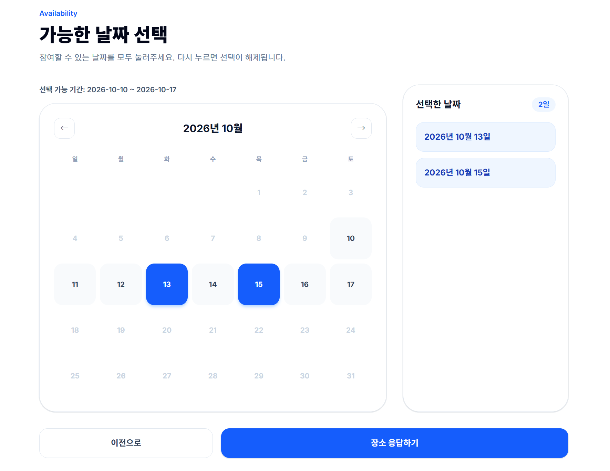
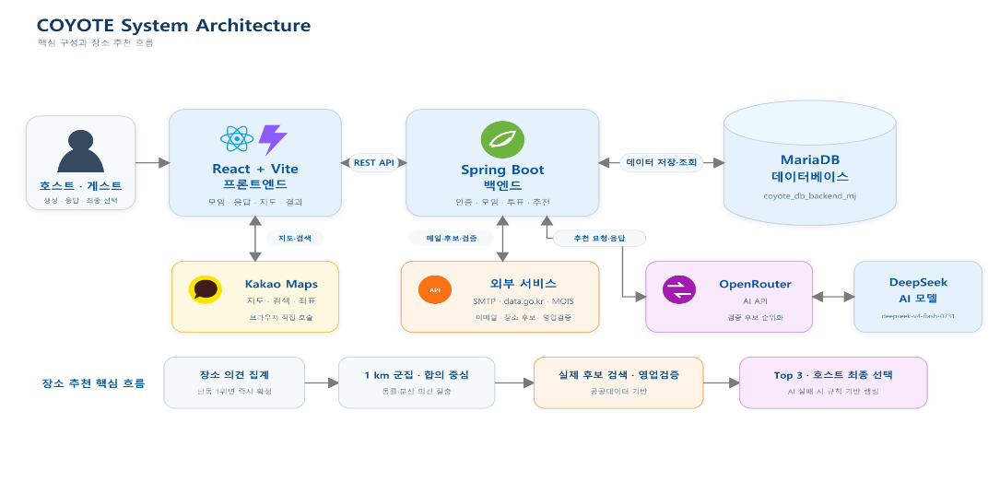
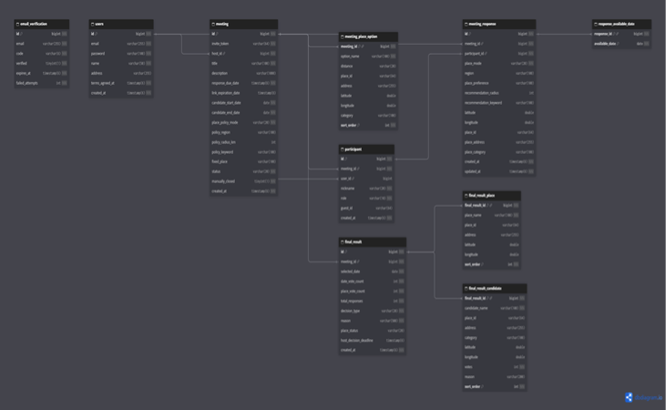

<h1 align="center">
  
</h1>

<p align="center">
  참여자의 가능한 날짜와 희망 장소를 모아<br>
  <strong>모임의 일정과 장소를 함께 정하는 웹 서비스</strong>
</p>

<p align="center">
  <a href="https://coyote-meeting.namse-coyote.workers.dev"><strong>서비스 둘러보기 ↗</strong></a>
  &nbsp; · &nbsp; <a href="#서비스-소개">서비스 소개</a>
  &nbsp; · &nbsp; <a href="#아키텍처">아키텍처</a>
  &nbsp; · &nbsp; <a href="#데이터-모델">ERD</a>
  &nbsp; · &nbsp; <a href="#핵심-설계">핵심 설계</a>
  &nbsp; · &nbsp; <a href="#시작하기">실행 가이드</a>
</p>

<br>

## 서비스 소개

대화방에 흩어진 날짜와 장소 의견을 한곳에서 모읍니다. 호스트는 모임을 만들고 링크를 공유하며, 참여자는 가능한 날짜와 장소 의견을 제출합니다. 모여ON은 투표 집계와 위치 분석, AI 장소 후보 선정을 연결해 다음 결정을 돕습니다.

<table>
  <tr>
    <td width="50%" valign="top">
      <a href="frontend/public/images/landing/step-01-create.png">
        
      </a>
      <p><strong>01 · 모임의 조건을 정하고</strong><br>
      <sub>후보 날짜, 응답 마감일과 장소 결정 방식을 설정합니다.</sub></p>
    </td>
    <td width="50%" valign="top">
      <a href="frontend/public/images/landing/step-03-dates.png">
        
      </a>
      <p><strong>02 · 가능한 날짜를 모읍니다</strong><br>
      <sub>참여자는 달력에서 날짜를 고르고 장소 의견을 제출합니다.</sub></p>
    </td>
  </tr>
</table>

**모임 생성 → 초대 링크 공유 → 날짜·장소 응답 → 응답 마감 → 결과 확인**

| 할 수 있는 일 | 동작 |
| --- | --- |
| **링크로 참여** | 회원가입 없이 닉네임을 입력하고 참여합니다. |
| **날짜 투표** | 가능한 날짜를 제출하고 마감 전까지 수정합니다. 최다 득표 날짜가 모임 날짜가 됩니다. |
| **장소 조율** | 호스트가 장소를 지정하거나 추천 후보를 제공합니다. 장소를 미리 정하지 않았다면 참여자가 직접 제안하거나 의견을 건너뛸 수 있습니다. |
| **결과 확인** | 날짜와 장소 집계 결과를 확인합니다. 공동 1위나 공간 분석 후보 등 추가 선택이 필요한 경우 호스트가 장소를 정합니다. |

<details>
<summary>날짜 집계와 AI의 역할</summary>

날짜는 투표 집계 규칙으로 결정합니다. 최다 득표 날짜가 여러 개면 오늘과 가장 가까운 날짜를 선택합니다. AI는 검색된 **장소 후보의 선정과 추천 이유 제안**에 사용합니다.

</details>

<br>

## 아키텍처

<p align="center">
  <a href="docs/assets/readme/architecture.png">
    
  </a>
</p>

<p align="center">
  <a href="docs/assets/readme/architecture.png">아키텍처 원본 보기</a>
  &nbsp; · &nbsp; <a href="deploy/ec2/README.md">배포 구성과 운영 문서</a>
</p>

서비스의 주요 구성과 장소 조율 흐름입니다. 그림 하단의 **Top 3 후보 생성은 모임 마감 후 추가 장소 분석이 필요한 경우**에 적용됩니다.

<details>
<summary>운영 배포 구성 보기</summary>

2026년 11월 14일 확인한 운영 구성 기준입니다. Cloudflare Workers Static Assets가 프론트엔드를 제공하고, Worker가 같은 출처의 `/api/*` 요청을 EC2의 Caddy로 전달합니다. Caddy·Spring Boot·MariaDB는 단일 EC2에서 Docker Compose로 실행하며, DB 포트는 호스트에 공개하지 않습니다.

배포 파일은 확인 당시의 스냅샷입니다. 재배포할 때는 [배포 문서](deploy/ec2/README.md)에 따라 릴리스 파일명, 이미지 태그, SQL 적용 경로와 빌드 결과를 확인합니다.

[Worker 설정](frontend/wrangler.jsonc) · [API 전달 코드](frontend/worker.js)

</details>

<br>

## 데이터 모델

<p align="center">
  <a href="docs/assets/readme/erd.png">
    
  </a>
</p>

<p align="center">
  <a href="docs/assets/readme/erd.png">ERD 원본 보기</a>
  &nbsp; · &nbsp; <a href="sql/coyote_backend_mj_schema.sql">전체 SQL 스키마</a>
  &nbsp; · &nbsp; <a href="sql/README.md">스키마 적용·변경 안내</a>
</p>

| 영역 | 주요 테이블 |
| --- | --- |
| 회원·인증 | `users`, `email_verification` |
| 모임·참여 | `meeting`, `participant` |
| 날짜·장소 응답 | `meeting_response`, `response_available_date`, `meeting_place_option` |
| 최종 결과 | `final_result`, `final_result_place`, `final_result_candidate` |

세부 컬럼과 제약조건은 [SQL 원본](sql/coyote_backend_mj_schema.sql)에서 확인할 수 있습니다.

<br>

## 핵심 설계

### 01 · 마감 처리와 외부 API 작업 분리

**마감 상태와 날짜 결과를 먼저 저장하고, 추가 장소 후보 생성은 커밋 이후 별도 작업으로 실행합니다.** 외부 API를 기다리는 시간이 마감 트랜잭션의 잠금 유지 시간에 포함되지 않도록 구성했습니다. 장소 후보 처리에서도 입력 조회와 결과 저장의 트랜잭션을 나눴습니다.

[마감 처리](backend/src/main/java/com/coyote/moyeon/meeting/MeetingClosingService.java) · [장소 후보 생성·확정](backend/src/main/java/com/coyote/moyeon/meeting/PlaceDecisionService.java)

### 02 · 장소 데이터 검증과 호출 개선

**음식점·카페 후보를 행정안전부 데이터와 대조하고, 기본 설정에서 최대 8개 병렬 조회와 60초 메모리 캐시를 사용합니다.** 폐업 기록만 확인되는 후보를 제외하며, 조회 대기와 반복 호출을 줄이도록 구성했습니다.

[검증 범위와 설정](backend/docs/PLACE_DATA.md) · [병렬 조회·캐시 구현](backend/src/main/java/com/coyote/moyeon/place/MoisPlaceStatusVerifier.java)

### 03 · AI 응답 검증과 대체 추천

**AI가 실제 후보 목록 안에서 선택하도록 응답의 후보 번호를 검증합니다.** AI를 사용할 수 없거나 일일 호출 예산이 소진된 경우, 호출·응답 처리에 실패한 경우에는 규칙 기반 추천으로 전환합니다. 선택된 후보가 부족하면 나머지도 규칙 기반으로 보완합니다.

[AI 응답 검증](backend/src/main/java/com/coyote/moyeon/place/LlmPlaceRanker.java) · [추천 방식 전환](backend/src/main/java/com/coyote/moyeon/place/PlaceRankingService.java)

<details>
<summary>처리 범위와 예외 정책</summary>

- **비동기 처리:** 모임 마감 후 추가 후보 생성이 필요한 경우에 적용합니다. 사용자가 직접 요청하는 장소 추천 API는 결과를 받은 뒤 응답합니다.
- **영업상태 검증:** 음식점·카페가 대상이며, 비음식 업종에는 적용하지 않습니다. API 장애나 상호·주소 매칭 실패 시에는 기존 후보를 유지합니다. 조회 데이터가 현재 시각의 실제 영업 여부를 보장하지는 않습니다.
- **AI 후보 검증:** 범위를 벗어나거나 중복된 후보 번호를 제외합니다. AI 일일 호출 예산 소진 시의 대체 처리와 사용자별 API 요청 제한은 구분합니다.

</details>

<br>

## 기술 스택

| 영역 | 기술 | 소스·설정 |
| --- | --- | --- |
| **Frontend** | React 19 · Vite 8 · Tailwind CSS 4 | [frontend](frontend/) |
| **Backend** | Java 25 · Spring Boot 4.1.1 · Spring Security · Spring Data JPA | [backend](backend/) |
| **Database** | MariaDB 10.11 | [SQL](sql/) |
| **Infrastructure** | Cloudflare Workers · AWS EC2 · Docker Compose · Caddy | [배포 문서](deploy/ec2/README.md) |
| **Integration** | Kakao Maps · 소상공인시장진흥공단 상가정보 · 행정안전부 음식점 정보 · OpenRouter | [장소 데이터 운영](backend/docs/PLACE_DATA.md) |

<br>

## 시작하기

**JDK 25 · Node.js 24 권장 및 npm · MariaDB 서버와 CLI**를 준비합니다.

<details>
<summary><strong>로컬 실행 순서</strong></summary>

아래 명령은 저장소를 내려받은 뒤 루트 디렉터리에서 시작하는 Bash/WSL 기준입니다.

### 1. DB 스키마 생성

새 DB를 준비할 때 다음 스키마를 적용합니다. 기존 DB를 변경하는 경우에는 먼저 [SQL 적용 안내](sql/README.md)를 확인합니다.

```bash
mariadb -u root -p < sql/coyote_backend_mj_schema.sql
```

### 2. 백엔드 설정

```bash
cp backend/.env.example backend/.env
```

`backend/.env`에서 실제 DB 접속 정보와 JWT 비밀키를 설정합니다. 백엔드를 `backend/`에서 실행하면 이 파일을 읽습니다.

| 설정 | 용도 |
| --- | --- |
| `DB_URL` | 연결할 MariaDB 주소. 예제의 기본 DB는 `coyote_db_backend_mj`입니다. |
| `DB_USERNAME`, `DB_PASSWORD` | 스키마에 접근할 수 있는 DB 계정 |
| `JWT_SECRET` | UTF-8 기준 32바이트 이상의 임의 비밀값 |
| `DATA_GO_KR_SERVICE_KEY` | 장소 검색 사용 시 설정 |
| `MOIS_DATA_GO_KR_SERVICE_KEY` | 음식점·카페 검증 키. 별도 설정이 없으면 공공데이터 기본 키를 사용합니다. |
| `OPENROUTER_API_KEY` | AI 추천 사용 시 설정. 키가 없으면 규칙 기반 추천을 사용합니다. |

장소 검색 키가 없으면 장소 검색은 비활성화됩니다. 로컬 기본 설정인 `MAIL_PROVIDER=log`에서는 실제 메일을 보내는 대신 인증번호를 백엔드 콘솔에서 확인할 수 있습니다. 실제 이메일 발송이 필요하면 [환경변수 예제](backend/.env.example)의 SMTP 설정을 적용합니다. 실제 키와 비밀번호는 Git에 커밋하지 않습니다.

### 3. 백엔드 실행 — 터미널 1

```bash
cd backend
./gradlew bootRun
```

Windows PowerShell에서는 `./gradlew.bat bootRun`을 사용합니다.

### 4. 프론트엔드 설정·실행 — 새 터미널 2

새 터미널에서 저장소 루트로 이동한 뒤 설정 파일을 복사합니다.

```bash
cp frontend/.env.example frontend/.env.local
```

`frontend/.env.local`의 `VITE_API_BASE_URL`은 로컬 백엔드 주소인 `http://localhost:8080`을 사용합니다. 지도 기능을 사용하려면 `VITE_KAKAO_MAP_KEY`에 카카오 JavaScript 키를 설정하고, 카카오 개발자 콘솔에서 카카오맵 사용 설정을 켠 뒤 웹 주소 `http://localhost:5173`을 등록합니다.

```bash
cd frontend
npm ci
npm run dev
```

서비스는 [http://localhost:5173](http://localhost:5173)에서 사용하고, 백엔드 기동 상태는 [http://localhost:8080/api/health](http://localhost:8080/api/health)에서 확인합니다. 로컬에서는 프론트엔드가 설정된 백엔드 주소로 직접 요청합니다.

</details>

<details>
<summary><strong>테스트·린트·빌드 명령</strong></summary>

저장소 루트에서 실행합니다.

```bash
cd backend
./gradlew test

cd ../frontend
npm ci
npm run lint
npm run build
```

Windows PowerShell의 백엔드 테스트 명령은 `./gradlew.bat test`입니다.

백엔드 테스트는 인증, 모임 참여, 투표, 결과 생성, 장소 추천 등을 다룹니다. [테스트 프로필](backend/src/test/resources/application-test.properties)은 H2와 테스트용 장소·AI 제공자를 사용하므로, 실제 외부 API 연결과 운영 환경의 동작은 별도로 확인해야 합니다.

[백엔드 테스트 코드](backend/src/test/java/com/coyote/moyeon/)

</details>

<br>

## 팀 COYOTE

| 팀원 | 역할 | 담당 |
| --- | --- | --- |
| **남성천** | Project Lead & Deployment | 프로젝트 기획·진행 조율, Cloudflare·AWS EC2 배포 |
| **박정은** | Frontend & SQL | React 기반 웹 UI/UX 설계·개발, MariaDB ERD 설계·테이블 구축 |
| **이민정** | Frontend & Backend | API 설계·구현, SMTP 이메일 인증, 장소 추천·결과 화면 일부 구현 |

<br>

## 문서 바로가기

| 문서 | 담고 있는 내용 |
| --- | --- |
| [배포·운영](deploy/ec2/README.md) | Compose·Caddy 구성, 배포 절차와 운영 스냅샷 |
| [장소 데이터](backend/docs/PLACE_DATA.md) | 데이터 출처, 검증 범위, 병렬 조회와 캐시 설정 |
| [DB 스키마](sql/README.md) | 새 DB 생성과 기존 DB 변경 절차 |
| [백엔드 테스트](backend/src/test/java/com/coyote/moyeon/) | 인증, 참여, 투표, 결과와 장소 추천 검증 코드 |

