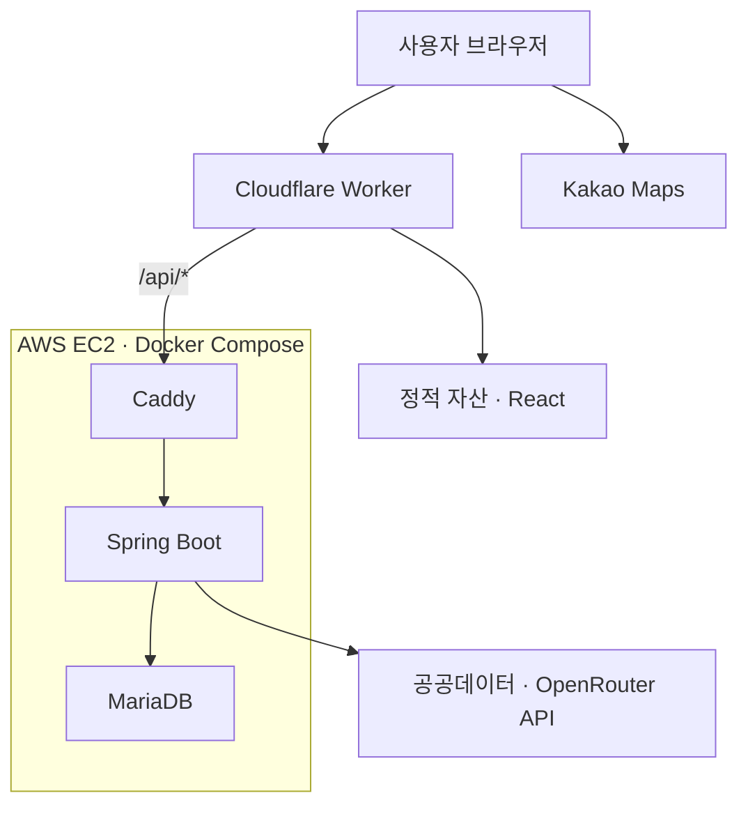

# 모여ON (COYOTE)

**언제, 어디서 만날지 함께 정하는 모임 조율 서비스**

모여ON은 초대 링크로 참여자의 가능한 날짜와 희망 장소를 모아, 모임의 일정과 장소를 정할 수 있도록 돕습니다. 대화방에 흩어진 응답을 한곳에서 수집하고, 날짜 투표 집계와 위치 기반 장소 조율, AI 장소 후보 선정을 연결했습니다.

[서비스 바로가기](https://coyote-meeting.namse-coyote.workers.dev) · [주요 기능](#주요-기능) · [시스템 아키텍처](#시스템-아키텍처) · [설계와 문제 해결](#주요-설계와-문제-해결) · [실행 방법](#실행-및-검증)

<table>
  <tr>
    <th width="50%">모임 생성</th>
    <th width="50%">가능한 날짜 선택</th>
  </tr>
  <tr>
    <td></td>
    <td></td>
  </tr>
</table>

## 주요 기능

**모임 생성 → 초대 링크 공유 → 날짜·장소 응답 → 응답 마감 → 결과 확인**

| 기능 | 설명 |
| --- | --- |
| 모임 생성 | 모임 정보, 후보 날짜 범위, 응답 마감일과 장소 결정 방식을 설정합니다. |
| 초대 링크 참여 | 회원가입 없이 초대 링크에서 닉네임을 입력하고 모임에 참여할 수 있습니다. |
| 가능한 날짜 응답 | 참여 가능한 날짜를 제출하고 마감 전까지 응답을 수정합니다. 마감 시 최다 득표 날짜를 선정합니다. |
| 장소 의견 조율 | 호스트가 장소를 지정하거나 추천 후보를 제공할 수 있습니다. 장소를 미리 정하지 않은 모임에서는 참여자가 장소를 제안하거나 의견을 건너뛸 수 있습니다. |
| 결과 확인·최종 선택 | 날짜와 장소 집계 결과를 확인합니다. 장소 공동 1위나 공간 분석 후보 등 추가 선택이 필요한 경우에는 호스트가 최종 장소를 정합니다. |

날짜는 투표 집계 규칙으로 결정하며, 최다 득표 날짜가 여러 개면 오늘과 가장 가까운 날짜를 선택합니다. AI는 검색된 **장소 후보의 선정과 추천 이유 제안**에 사용합니다.

## 시스템 아키텍처

2026년 11월 14일 확인한 운영 구성 기준입니다.



Cloudflare Workers Static Assets가 프론트엔드를 제공하고, Worker가 같은 출처의 `/api/*` 요청을 EC2의 Caddy로 전달합니다. Caddy·Spring Boot·MariaDB는 단일 EC2에서 Docker Compose로 실행하며, DB 포트는 호스트에 공개하지 않습니다.

| 영역 | 기술과 역할 | 코드·설정 |
| --- | --- | --- |
| Frontend | React 19, Vite 8, Tailwind CSS 4 — 화면 구성과 사용자 입력 | [frontend](frontend/) |
| Backend | Java 25, Spring Boot 4.1.1, Spring Security, Spring Data JPA — 인증과 모임·투표·추천 처리 | [backend](backend/) |
| Database | MariaDB 10.11 — 운영 데이터 저장 | [스키마·변경 스크립트](sql/README.md) |
| Deployment | Cloudflare Workers Static Assets, AWS EC2, Docker Compose, Caddy | [Worker 설정](frontend/wrangler.jsonc) · [EC2 배포](deploy/ec2/README.md) |
| External APIs | Kakao Maps, 소상공인시장진흥공단 상가정보, 행정안전부 음식점 정보, OpenRouter | [장소 데이터 운영](backend/docs/PLACE_DATA.md) |

배포 파일은 확인 당시의 운영 스냅샷입니다. 재배포할 때는 [배포 문서](deploy/ec2/README.md)에 따라 릴리스 파일명, 이미지 태그, SQL 적용 경로와 빌드 결과를 확인합니다.

## 주요 설계와 문제 해결

### 1. 마감 트랜잭션과 장소 후보 생성 분리

외부 API가 필요한 장소 후보 생성은 모임 마감 트랜잭션의 커밋 이후 별도 작업으로 실행합니다. 마감 상태와 날짜 결과를 먼저 저장하고, 외부 API를 기다리는 시간이 마감 트랜잭션의 잠금 유지 시간에 포함되지 않도록 구성했습니다. 장소 후보 처리에서는 입력 조회와 결과 저장에도 각각 별도 트랜잭션을 사용합니다.

이 처리는 추가 후보 생성이 필요한 모임에 적용됩니다. 사용자가 직접 요청하는 장소 추천 API는 결과를 받은 뒤 응답하는 방식입니다.

[마감 처리](backend/src/main/java/com/coyote/moyeon/meeting/MeetingClosingService.java) · [장소 후보 생성·확정](backend/src/main/java/com/coyote/moyeon/meeting/PlaceDecisionService.java)

### 2. 장소 데이터 검증과 병렬 조회·캐시

음식점·카페 검색 후보를 행정안전부 데이터와 대조해 폐업 기록만 확인되는 후보를 제외합니다. 검증 대기와 반복 호출을 줄이기 위해 기본 설정에서 **최대 8개 병렬 조회와 60초 메모리 캐시**를 사용합니다.

API 장애나 상호·주소 매칭 실패 시에는 기존 후보를 유지합니다. 비음식 업종은 이 검증 대상에 포함되지 않으며, 데이터 조회 결과가 현재 시각의 실제 영업 여부를 보장하지는 않습니다.

[검증 범위·설정](backend/docs/PLACE_DATA.md) · [병렬 조회·캐시 구현](backend/src/main/java/com/coyote/moyeon/place/MoisPlaceStatusVerifier.java)

### 3. AI 후보 검증과 규칙 기반 대체

AI가 검색된 후보 목록 안에서 장소를 선택하고 추천 이유를 제안하도록 구성했습니다. 응답의 후보 번호를 검증해 범위를 벗어나거나 중복된 선택을 제외하고, AI 사용 불가·AI 일일 호출 예산 소진·AI 호출 또는 응답 처리 실패 시에는 규칙 기반 추천으로 전환합니다. AI가 선택한 후보가 부족하면 나머지도 규칙 기반으로 보완합니다.

[AI 응답 검증](backend/src/main/java/com/coyote/moyeon/place/LlmPlaceRanker.java) · [추천 방식 전환](backend/src/main/java/com/coyote/moyeon/place/PlaceRankingService.java)

## 실행 및 검증

**준비 환경:** JDK 25, Node.js 24 권장 및 npm, 실행 중인 MariaDB 서버와 MariaDB CLI.

<details>
<summary><strong>로컬 실행 순서</strong></summary>

아래 명령은 저장소를 내려받은 뒤 루트 디렉터리에서 시작하는 Bash/WSL 기준입니다.

### 1. DB 스키마 생성

새 DB를 준비할 때 다음 스키마를 적용합니다. 기존 DB를 변경하는 경우에는 먼저 [SQL 적용 안내](sql/README.md)를 확인합니다.

```bash
mariadb -u root -p < sql/coyote_backend_mj_schema.sql
```

### 2. 백엔드 설정

```bash
cp backend/.env.example backend/.env
```

`backend/.env`에서 실제 DB 접속 정보와 JWT 비밀키를 설정합니다. 백엔드를 `backend/`에서 실행하면 이 파일을 읽습니다.

| 설정 | 용도 |
| --- | --- |
| `DB_URL` | 연결할 MariaDB 주소. 예제의 기본 DB는 `coyote_db_backend_mj`입니다. |
| `DB_USERNAME`, `DB_PASSWORD` | 스키마에 접근할 수 있는 DB 계정 |
| `JWT_SECRET` | UTF-8 기준 32바이트 이상의 임의 비밀값 |
| `DATA_GO_KR_SERVICE_KEY` | 장소 검색 사용 시 설정 |
| `MOIS_DATA_GO_KR_SERVICE_KEY` | 음식점·카페 검증 키. 별도 설정이 없으면 공공데이터 기본 키를 사용합니다. |
| `OPENROUTER_API_KEY` | AI 추천 사용 시 설정. 키가 없으면 규칙 기반 추천을 사용합니다. |

장소 검색 키가 없으면 장소 검색은 비활성화됩니다. 로컬 기본 설정인 `MAIL_PROVIDER=log`에서는 실제 메일을 보내는 대신 인증번호를 백엔드 콘솔에서 확인할 수 있습니다. 실제 이메일 발송이 필요하면 [환경변수 예제](backend/.env.example)의 SMTP 설정을 적용합니다. 실제 키와 비밀번호는 Git에 커밋하지 않습니다.

### 3. 백엔드 실행 — 터미널 1

```bash
cd backend
./gradlew bootRun
```

Windows PowerShell에서는 `./gradlew.bat bootRun`을 사용합니다.

### 4. 프론트엔드 설정·실행 — 새 터미널 2

새 터미널에서 저장소 루트로 이동한 뒤 설정 파일을 복사합니다.

```bash
cp frontend/.env.example frontend/.env.local
```

`frontend/.env.local`의 `VITE_API_BASE_URL`은 로컬 백엔드 주소인 `http://localhost:8080`을 사용합니다. 지도 기능을 사용하려면 `VITE_KAKAO_MAP_KEY`에 카카오 JavaScript 키를 설정하고, 카카오 개발자 콘솔에서 카카오맵 사용 설정을 켠 뒤 웹 주소 `http://localhost:5173`을 등록합니다.

```bash
cd frontend
npm ci
npm run dev
```

서비스는 [http://localhost:5173](http://localhost:5173)에서 사용하고, 백엔드 기동 상태는 [http://localhost:8080/api/health](http://localhost:8080/api/health)에서 확인합니다. 로컬에서는 프론트엔드가 설정된 백엔드 주소로 직접 요청합니다.

</details>

<details>
<summary><strong>테스트·린트·빌드 명령</strong></summary>

저장소 루트에서 실행합니다.

```bash
cd backend
./gradlew test

cd ../frontend
npm ci
npm run lint
npm run build
```

Windows PowerShell의 백엔드 테스트 명령은 `./gradlew.bat test`입니다.

백엔드 테스트는 인증, 모임 참여, 투표, 결과 생성, 장소 추천 등을 다룹니다. [테스트 프로필](backend/src/test/resources/application-test.properties)은 H2와 테스트용 장소·AI 제공자를 사용하므로, 실제 외부 API 연결과 운영 환경의 동작은 별도로 확인해야 합니다.

[백엔드 테스트 코드](backend/src/test/java/com/coyote/moyeon/)

</details>

## 팀 COYOTE

| 팀원 | 담당 |
| --- | --- |
| 남성천 | 프로젝트 기획·진행 조율, Cloudflare·AWS EC2 배포 |
| 박정은 | React 기반 웹 UI/UX 설계·개발, MariaDB ERD 설계·테이블 구축 |
| 이민정 | API 설계·구현, SMTP 이메일 인증, 장소 추천·결과 화면 일부 구현 |

## 관련 문서

- [EC2 운영 배포](deploy/ec2/README.md) — Compose·Caddy 구성, 배포 절차와 운영 스냅샷
- [장소 데이터 운영](backend/docs/PLACE_DATA.md) — 데이터 출처, 영업상태 검증 범위, 병렬 조회·캐시 설정
- [DB 스키마·변경 안내](sql/README.md) — 새 DB 생성과 기존 DB 변경 절차

